<!-- Every panel below is rendered by generator/build.py and served from the output branch. -->

<picture>
  <source media="(max-width: 640px)" srcset="https://raw.githubusercontent.com/MTaylanOzturk/MTaylanOzturk/output/hero-narrow.svg" />
  
</picture>

I started writing code at <b>15</b> and never stopped. Today I build backend systems in the <b>Java ecosystem</b> at <b>AesirMC</b>, a live game server network, while studying <b>Software Engineering</b> at <b>Aksaray University</b>.

<b>800K+ lines of Java</b> across 29 projects, most of them private, so the numbers below count private work too.

  
  
  

<picture>
  <source media="(max-width: 640px)" srcset="https://raw.githubusercontent.com/MTaylanOzturk/MTaylanOzturk/output/stats-narrow.svg" />
  
</picture>

<picture>
  <source media="(max-width: 640px)" srcset="https://raw.githubusercontent.com/MTaylanOzturk/MTaylanOzturk/output/city-narrow.svg" />
  
</picture>

<picture>
  <source media="(max-width: 640px)" srcset="https://raw.githubusercontent.com/MTaylanOzturk/MTaylanOzturk/output/activity-narrow.svg" />
  
</picture>

<picture>
  <source media="(max-width: 640px)" srcset="https://raw.githubusercontent.com/MTaylanOzturk/MTaylanOzturk/output/languages-narrow.svg" />
  
</picture>

<picture>
  <source media="(max-width: 640px)" srcset="https://raw.githubusercontent.com/MTaylanOzturk/MTaylanOzturk/output/trophies-narrow.svg" />
  
</picture>

<picture>
  <source media="(max-width: 640px)" srcset="https://raw.githubusercontent.com/MTaylanOzturk/MTaylanOzturk/output/stack-narrow.svg" />
  
</picture>

  <a href="https://github.com/MTaylanOzturk/LeafSWM"><picture><source media="(max-width: 640px)" srcset="https://raw.githubusercontent.com/MTaylanOzturk/MTaylanOzturk/output/repo-1-narrow.svg" /></picture></a>
  <a href="https://github.com/MTaylanOzturk/FallingLeaves"><picture><source media="(max-width: 640px)" srcset="https://raw.githubusercontent.com/MTaylanOzturk/MTaylanOzturk/output/repo-2-narrow.svg" /></picture></a>

  <picture>
    <source media="(prefers-color-scheme: dark)" srcset="https://raw.githubusercontent.com/MTaylanOzturk/MTaylanOzturk/output/snake-dark.svg" />
    <source media="(prefers-color-scheme: light)" srcset="https://raw.githubusercontent.com/MTaylanOzturk/MTaylanOzturk/output/snake.svg" />
    
  </picture>

<picture>
  <source media="(max-width: 640px)" srcset="https://raw.githubusercontent.com/MTaylanOzturk/MTaylanOzturk/output/footer-narrow.svg" />
  
</picture>

  

